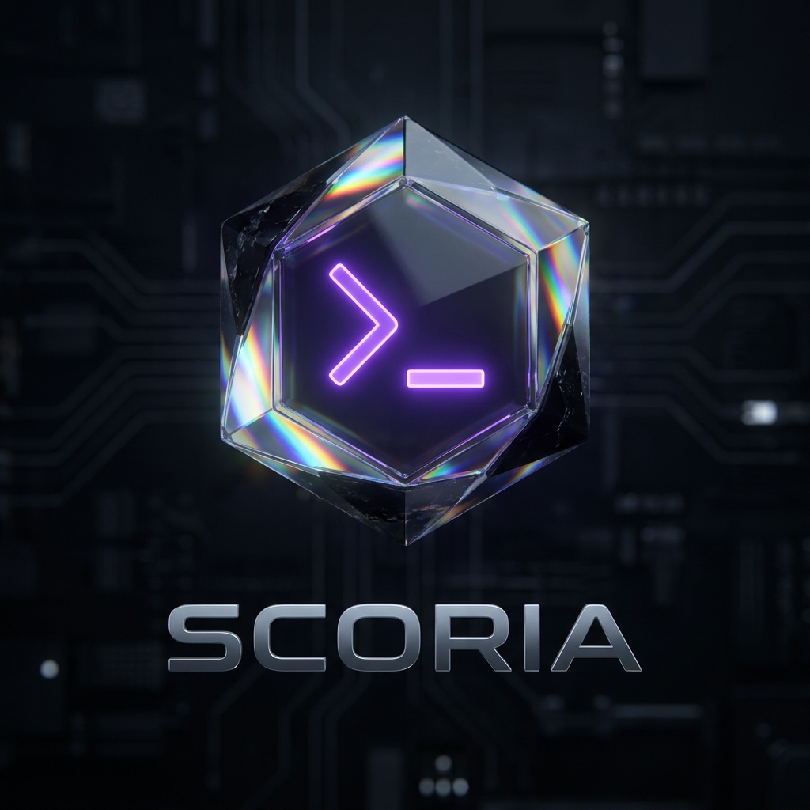
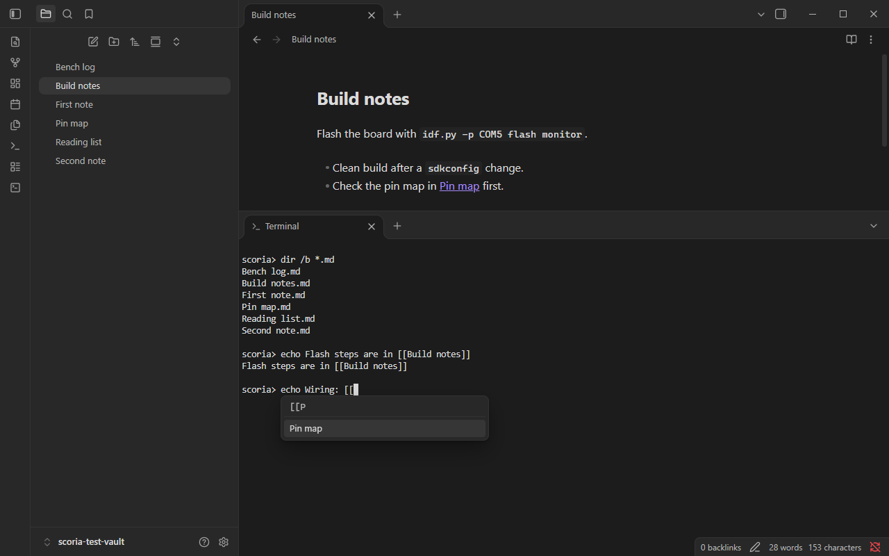
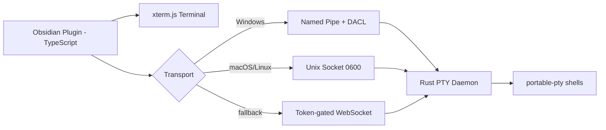

<div align="center">

# Scoria



*A secure, persistent, cross-platform terminal that lives inside Obsidian.*

[](./manifest.json)
[](https://obsidian.md/)
[](./LICENSE)
[](./rust-servers)
[](https://github.com/TfTHacker/obsidian42-brat)

[Why Scoria](#why-scoria) · [Status](#where-this-is) · [Install](#install) · [Features](#features) · [Architecture](#architecture) · [Roadmap](#roadmap)



</div>

---

## Why Scoria

A terminal inside Obsidian should be boring in the best way: it should be there when you open the vault, survive a reload without losing your shell, and not open a hole in your machine while doing it.

Scoria started as a fork of [Termy](https://github.com/ZyphrZero/Termy), which already had the right shape - xterm.js in the renderer, a real PTY running out of process in a Rust backend. Two things stopped it from being something I would hand to other people:

- **The backend was open.** The PTY server listened on an unauthenticated local WebSocket (`127.0.0.1:<port>`). Any local process could connect and drive a shell with your permissions.
- **Sessions did not survive.** Reloading Obsidian, or a transient transport drop, killed the running shell. Long jobs died with the window.

Scoria rebuilds that foundation:

- **Authenticated transport.** On Windows the PTY runs over a named pipe locked to your user with a DACL; on macOS and Linux over a Unix domain socket with `0600` permissions in an owner-only directory; the WebSocket fallback now requires a capability token. The pipe and the socket need no secret: the OS checks who connects. The WebSocket fallback sends its 256-bit token in the first message, and only over loopback.
- **A persistent daemon.** The PTY backend outlives the plugin. Reload Obsidian and your shells reattach, with the output you missed replayed back into the same terminal.
- **Cross-platform from one codebase.** The same transport story works on Windows, macOS, and Linux, picking the right primitive per OS.
- **Its own binary.** Scoria downloads its PTY backend from this project's own GitHub Releases - the authenticated build from this repo - and never from a third-party host.

The inherited Termy surface (multiple shells, splits, workflows, AI CLI launchers, drag-and-drop, clickable output) is still here. Scoria's contribution is the layer underneath it.

## Where this is

**Public beta.** The security, persistence, and cross-platform work is merged and reviewed. What remains before a 1.0 is hardening in real use and the polish that only early users surface.

- **Not yet in the Obsidian community directory.** Install with BRAT or manually for now (see [Install](#install)). Listing is a planned post-beta step, not a blocker.
- **Desktop only.** The native PTY backend rules out mobile.
- **macOS:** the binary is built in CI, and the socket checks (owner-only socket and directory, per-user temp dir, path length) pass on the CI macOS runner. Nobody has run it on Mac hardware yet, and the binary is not code-signed or notarized.

Honest scope: today Scoria is a *secure, persistent, cross-platform* Obsidian terminal. Deeper vault-native features - semantic command tracking, sending command output straight into a note - are the next milestone, not a current claim. See [Roadmap](#roadmap).

## Install

### BRAT (recommended for the beta)

1. Install [BRAT](https://github.com/TfTHacker/obsidian42-brat) from the community plugins.
2. In BRAT settings choose **Add beta plugin**.
3. Enter `VaibhavAher100/scoria`.
4. Enable **Scoria** in **Settings → Community plugins**.

### Manual

1. Download the latest release from [GitHub Releases](https://github.com/VaibhavAher100/scoria/releases).
2. Extract `main.js`, `manifest.json`, and `styles.css` into `.obsidian/plugins/scoria/` in your vault.
3. Reload Obsidian and enable **Scoria** in **Settings → Community plugins**.

On first launch Scoria fetches the matching PTY backend for your platform from this repo's releases. No local Rust toolchain is needed to use it.

### Requirements

- Obsidian Desktop (Windows, macOS, or Linux)

## Quick start

1. Open Scoria from the ribbon, command palette, or status bar.
2. Pick your shell and where new terminals open in settings.
3. Open a terminal in the current note's folder with **Open terminal here** (right-click a file) or the matching command.
4. Run a long job, reload Obsidian, and watch the shell reattach.
5. Send a selection, the current note, or its path into the terminal.
6. Click a `[[wikilink]]`, `obsidian://` URL, or file path printed in the output to jump to it.

## Features

### The foundation (what Scoria adds)

- **Authenticated PTY transport** per OS: user-scoped named pipe (Windows), `0600` Unix domain socket (macOS/Linux), token-gated WebSocket fallback.
- **Reload-surviving sessions** through a persistent daemon, with bounded replay of missed output on reattach.
- **Own-host binary provenance** - the backend comes only from this project's GitHub Releases and is checked against a SHA-256 hash pinned inside the plugin. A download that does not match is deleted and never runs; at startup, a backend that does not match the pin is downloaded again. Offline mode skips this check (see [Privacy](#privacy-and-network-access)).
- **Vault-aware terminals** - launch in a note's folder, `[[` wikilink autocomplete at the prompt (opt-in in settings), clickable `[[wikilinks]]` and `obsidian://` links in output, copy-on-select.

### Inherited from Termy

- Local shells on Windows, macOS, and Linux: `cmd`, PowerShell, PowerShell Core, WSL, Git Bash, `bash`, `zsh`, or a custom path.
- Splits, tab groups, new-window placement, search, prompt navigation, font resize, copy/paste.
- Reusable workflows mixing terminal commands, Obsidian commands, and external links, launched from the status bar or palette.
- Send the editor selection, full note, or note path into the active terminal; drag files and folders in to paste resolved paths.
- AI CLI launchers (Claude Code, Codex CLI, OpenCode, Gemini CLI) started inside the current vault context.
- Theme sync, Canvas/WebGL rendering, background images and blur, localized UI.

## Architecture



The renderer never owns the PTY. xterm.js draws the terminal; the actual shell runs in a separate Rust process and talks to the plugin over an OS-authenticated transport. That process is a daemon - it stays alive across plugin reloads so sessions persist, and it is reachable only by your own user.

- **Frontend:** TypeScript, Obsidian plugin APIs, xterm.js.
- **Backend:** Rust PTY daemon on `portable-pty`, framed binary protocol (`[len:u32 LE][type:u8][payload]`).
- **Transport:** named pipe / Unix domain socket / authenticated WebSocket, chosen per platform.

## Roadmap

- **Now (beta):** stabilize in real use, confirm macOS on real hardware, gather early-user feedback.
- **Next (M5):** semantic shell integration (full OSC 133/633 command lifecycle - per-command status, navigation) and vault capture - send command output straight into a note.
- **Later:** broader feature parity (per-tab colour, tab hotkeys, startup commands), then submission to the Obsidian community directory.

## Development

```bash
pnpm install
pnpm build         # tsc check, production bundle, smoke check
pnpm build:rust    # build the native PTY backend
pnpm install:dev <vault-path>   # build everything and install into a dev vault
```

| Script | Purpose |
| --- | --- |
| `pnpm dev` | Frontend build/watch. |
| `pnpm build` | TypeScript check, production bundle, bundle smoke check. |
| `pnpm build:rust` | Build native PTY backend binaries. |
| `pnpm install:dev <vault>` | Build and install into a local dev vault (`--no-rust` to skip the native rebuild). |
| `pnpm test:terminal` | Compile and run the terminal-layer Node tests. |

## Privacy and network access

- No telemetry, no analytics.
- On first use Scoria downloads the matching PTY backend from this project's **own** GitHub Releases (`VaibhavAher100/scoria`) and verifies it against a SHA-256 hash pinned in the plugin bundle. It never downloads from a third-party host.
- Offline mode turns off downloads and update checks. It also skips the hash check: Scoria runs whatever backend is in the plugin's `binaries/` folder.
- Terminal sessions run local shell commands. Those commands can read files, write files, or reach the network according to what you run - the same as any terminal.
- The PTY transport is local and authenticated to your user (named pipe / `0600` socket / token-gated WebSocket). Only the WebSocket fallback sends a secret, and it sends its token over loopback.
- AI CLI launchers can pass the active note path, selection, and vault root to local CLI tools you start. The Codex integration writes a vault-local helper skill under `.agents/skills/`.

## License and attribution

Scoria is licensed under [GPL-3.0](./LICENSE).

Scoria is a modified fork of [Termy](https://github.com/ZyphrZero/Termy) by ZyphrZero, also GPL-3.0. The original is © ZyphrZero and the Termy contributors; Scoria's modifications are © Vaibhav Aher. The full attribution and a dated list of significant changes are in [NOTICE](./NOTICE).

## Credits

- [Termy](https://github.com/ZyphrZero/Termy) - the fork this is built on.
- [xterm.js](https://xtermjs.org/)
- [portable-pty](https://github.com/wez/wezterm/tree/main/pty)
</content>
</invoke>
